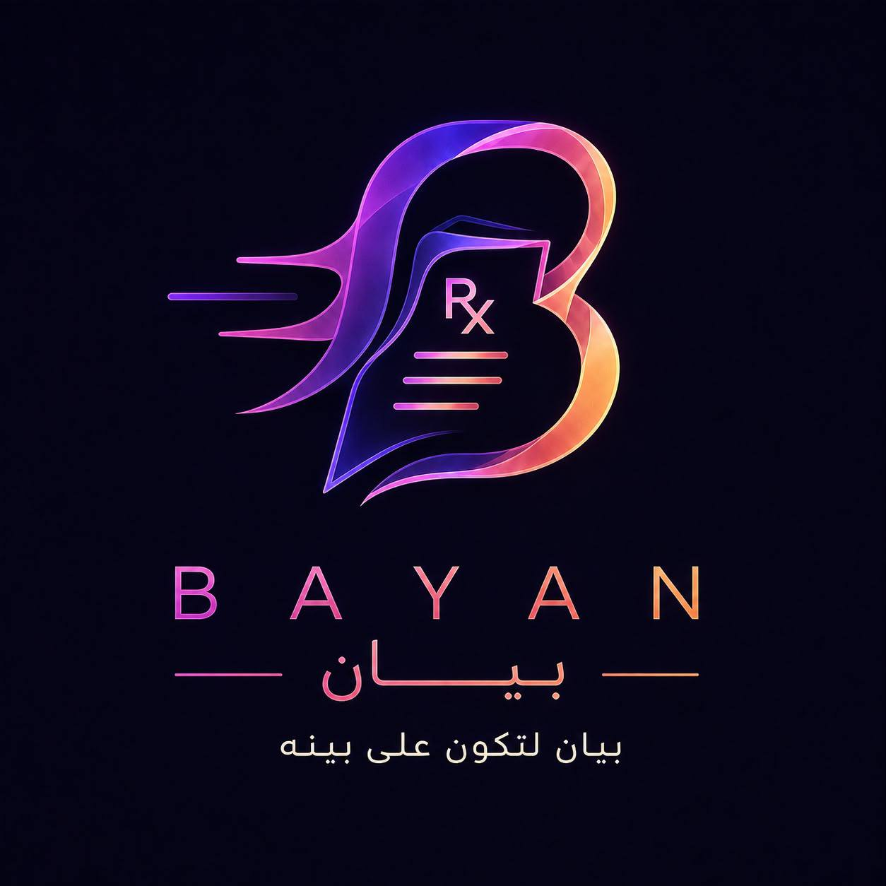

<div align="center">



# BAYAN · بيان

**Bilingual, pictogram-based medication labels for patients who don't read the pharmacy's language.**


</div>

---

## The problem

In multilingual healthcare settings, many patients receive medication labels written in a language they cannot read. A misread instruction ("three times daily" vs. "at bedtime") can lead to missed doses, overdoses, or dangerous side effects.

## The solution

BAYAN is a pharmacist workspace that turns a doctor's prescription into a **printable medication label** containing:

1. The original instruction in **English**
2. The same instruction translated into the **patient's preferred language** (with correct right-to-left layout for Arabic and Urdu)
3. **Pictograms** that communicate the dosing schedule visually, so the instructions stay clear whatever language the patient reads

## Key features

| Feature | Description |
|---|---|
| Patient directory | Search patients by name or Medical Record Number (MRN) |
| Patient profile | View demographics, preferred language, and prescribed medications |
| Label preview | Auto-generated bilingual label with pictograms per medication |
| Print workflow | Print a single label or all labels for a patient (print-optimized CSS) |
| 6 languages | Arabic, Urdu, Indonesian, Bengali, Turkish, French |
| RTL support | Right-to-left rendering for Arabic and Urdu |
| Hospital integration simulation | A mock hospital Clinical Information System that "sends" a prescription to BAYAN, demonstrating the intended integration flow |

## Demo flow

```
Hospital system (/hospital)
   │  Doctor's prescription is reviewed
   │  "Send Prescription to BAYAN"
   ▼
BAYAN patient profile (/patients/[mrn])
   │  Pharmacist reviews medications
   ▼
Label preview (/labels/[mrn]/[medicationId])
   │  English + patient language + pictograms
   ▼
Print 🖨️
```

## Routes

| Route | Purpose |
|---|---|
| `/` | Redirects to `/patients` |
| `/patients` | Patient directory with search |
| `/patients/[id]` | Patient profile and medication list |
| `/patients/[id]/print` | Print all labels for a patient |
| `/labels/[patientId]/[medicationId]` | Single label preview and print |
| `/hospital` | Simulated hospital patient directory |
| `/hospital/patients/[id]` | Simulated prescription screen ("Send to BAYAN") |

## Tech stack

- **Framework:** [Next.js](https://nextjs.org/) (App Router, static generation via `generateStaticParams`)
- **UI:** React 19 + [Tailwind CSS](https://tailwindcss.com/) v4
- **Language:** TypeScript
- **Linting:** ESLint (`eslint-config-next`)
- **Data:** Static TypeScript modules (no backend or database in the MVP)

## Project structure

```
bayan-mvp/
├── app/                      # Next.js App Router pages
│   ├── patients/             # Pharmacist workspace (directory, profile, print)
│   ├── labels/               # Single-label preview
│   └── hospital/             # Hospital integration simulation
├── components/               # Reusable UI components
│   ├── PhysicalMedicationLabel.tsx   # The printable label
│   ├── LabelPictograms.tsx
│   └── hospital/             # Hospital-simulator components
├── data/
│   ├── patients.ts           # Fictional demo patients
│   ├── translations.ts       # Instruction translations (6 languages)
│   └── pictograms.ts         # Pictogram catalog
├── lib/
│   └── pictogramRules.ts     # Maps instructions → pictograms
├── types/
│   └── patient.ts            # Patient & Medication types
└── public/
    ├── brand/                # Logo
    └── pictograms/           # Pictogram images
```

## Getting started

**Prerequisites:** Node.js **20.9 or later**

```bash
# 1. Clone the repository
git clone https://github.com/RawanAlghashmari/bayan-mvp.git
cd bayan-mvp

# 2. Install dependencies
npm install

# 3. Run the development server
npm run dev
```

Open [http://localhost:3000](http://localhost:3000).

| Script | Description |
|---|---|
| `npm run dev` | Start the development server |
| `npm run build` | Create a production build |
| `npm run start` | Serve the production build |
| `npm run lint` | Run ESLint |

No environment variables are required.

## Demo data disclaimer

> ⚠️ **All patient data in this repository is fictional** and was created for MVP demonstration purposes only. Patient names, MRNs, doctors, the hospital name ("Al Manar Medical Center"), and prescriptions do not represent real people or institutions.

## MVP scope and known limitations

This is a proof of concept, not a clinical product. Current limitations:

- **Fixed instruction set:** Translations and pictograms are mapped to a predefined list of five doctor instructions. Free-text instructions show "Translation not available".
- **Static data:** Patients and prescriptions are hard-coded; there is no database or API.
- **No authentication:** The pharmacist workspace has no login or role-based access.
- **Simulated integration:** The hospital → BAYAN flow is a UI simulation; no real HL7/FHIR messages are exchanged.
- **Translations not clinically validated:** Translations must be reviewed by qualified medical translators before any real-world use.

## Roadmap

- [ ] Structured instruction model (dose, frequency, timing, warnings) instead of exact-text matching
- [ ] Database and API layer for patients and prescriptions
- [ ] Pharmacist authentication and audit log
- [ ] Real EHR integration via HL7 FHIR (`MedicationRequest`)
- [ ] Clinically validated translations and more languages
- [ ] Label templates for common printer sizes

## Pictogram attribution

The pictograms in `public/pictograms/` are **USP Pictograms, © The United States Pharmacopeial Convention (USP)**. They are used unmodified, for non-commercial demonstration purposes, under USP's free license terms. All rights to the pictograms remain with USP. See [USP Pictograms](https://www.usp.org/health-quality-safety/usp-pictograms) for license terms.

The pictograms supplement, and never replace, the written instructions on each label.

## Team

Built by **Team BAYAN** · فريق بيان
